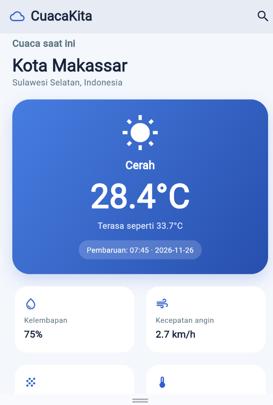
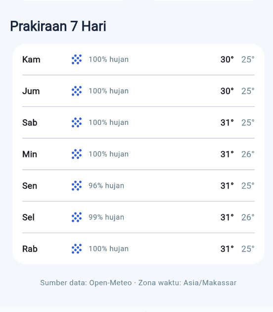
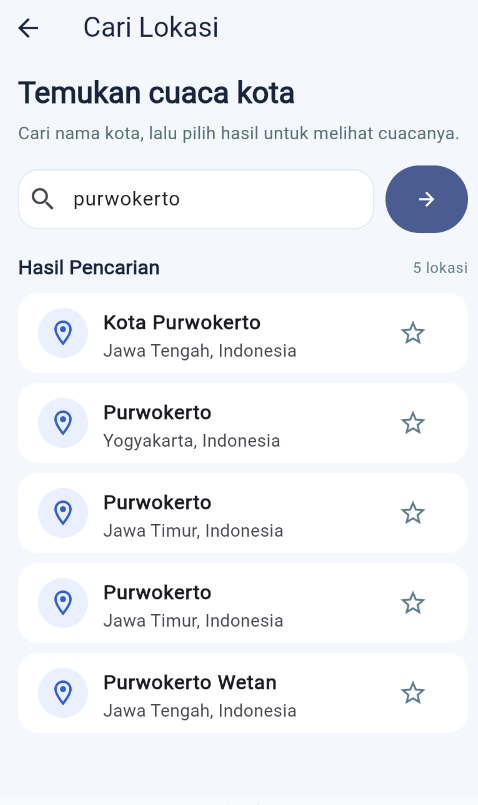
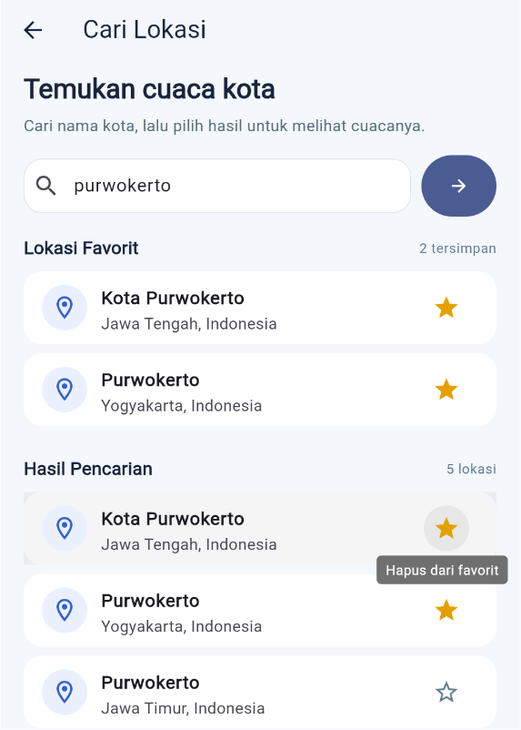

# CuacaKita - Aplikasi Informasi Cuaca Flutter

CuacaKita adalah aplikasi informasi cuaca yang dikembangkan menggunakan Flutter dan bahasa pemrograman Dart. Aplikasi mengambil lokasi kota melalui Open-Meteo Geocoding API, kemudian mengambil cuaca aktual dan prakiraan 7 hari melalui Open-Meteo Weather Forecast API.

> **Catatan pengerjaan:** Folder platform seperti `android/`, `ios/`, dan konfigurasi bawaan Flutter dibuat oleh perintah `flutter create`. Paket starter ini berisi kode aplikasi, pengujian, dan dokumentasi. Ikuti `docs/PANDUAN_PENGERJAAN.md` untuk membuat proyek Flutter utuh sebelum menjalankan kode.

## Fitur

1. Menampilkan lokasi kota yang sedang dipilih.
2. Menampilkan kondisi cuaca saat ini berdasarkan weather code Open-Meteo.
3. Menampilkan suhu, suhu terasa, kelembapan, curah hujan, dan kecepatan angin.
4. Menampilkan prakiraan cuaca selama 7 hari, suhu maksimum/minimum, dan peluang hujan maksimum.
5. Mencari kota menggunakan Open-Meteo Geocoding API.
6. Memilih hasil pencarian untuk memuat data cuaca kota tersebut.
7. Menyimpan dan menghapus lokasi favorit menggunakan SharedPreferences.
8. Menangani kondisi loading, hasil kosong, dan error jaringan/API.

## Teknologi

| Teknologi | Kegunaan |
|---|---|
| Flutter dan Dart | Pengembangan aplikasi dan antarmuka |
| Material 3 | Sistem desain UI |
| Provider + ChangeNotifier | State management pada ViewModel |
| http | HTTP GET ke Open-Meteo API |
| SharedPreferencesAsync | Penyimpanan daftar lokasi favorit secara lokal |
| Open-Meteo Geocoding API | Pencarian nama kota dan koordinat |
| Open-Meteo Weather Forecast API | Data cuaca aktual dan prakiraan harian |

## Screenshot aplikasi

Berikut dokumentasi tampilan aplikasi CuacaKita saat dijalankan. Screenshot mencakup halaman cuaca, prakiraan 7 hari, hasil pencarian kota, dan lokasi favorit.

### 1. Home / Weather Screen

Cuaca kota Makassar, meliputi kondisi saat ini, suhu, suhu terasa, dan informasi cuaca lainnya.



### 2. Prakiraan Cuaca 7 Hari

Menampilkan peluang hujan serta suhu maksimum dan minimum untuk tujuh hari.



### 3. Search / Location Screen

Menampilkan hasil pencarian lokasi berdasarkan kata kunci Purwokerto.



### 4. Lokasi Favorit

Menampilkan lokasi yang telah disimpan sebagai favorit.



## Struktur proyek

```text
lib/
├── main.dart
├── app.dart
├── core/
│   └── weather_code_helper.dart
├── data/
│   ├── models/
│   │   ├── location_model.dart
│   │   └── weather_model.dart
│   └── services/
│       ├── open_meteo_service.dart
│       └── favorite_storage_service.dart
└── features/
    ├── home/
    │   ├── viewmodels/
    │   │   └── weather_view_model.dart
    │   └── views/
    │       └── home_screen.dart
    └── search/
        ├── viewmodels/
        │   └── search_view_model.dart
        └── views/
            └── search_screen.dart

test/
└── weather_model_test.dart
```

## Penerapan MVVM

- **Model:** `LocationModel`, `CurrentWeather`, `DailyForecast`, dan `WeatherData` merepresentasikan data lokasi serta cuaca dalam bentuk objek Dart.
- **View:** `HomeScreen` dan `SearchScreen` membangun antarmuka. View membaca state dari ViewModel dan meneruskan tindakan pengguna.
- **ViewModel:** `WeatherViewModel` mengelola lokasi terpilih, pemuatan data cuaca, status loading, dan error. `SearchViewModel` mengelola pencarian kota dan daftar favorit.
- **Service:** `OpenMeteoService` bertanggung jawab untuk request HTTP dan parsing respons API. `FavoriteStorageService` menangani penyimpanan daftar favorit.

Alur data cuaca:

```text
HomeScreen
    ↓ meminta ViewModel memuat lokasi
WeatherViewModel
    ↓ memanggil service
OpenMeteoService
    ↓ HTTP GET
Open-Meteo Geocoding API → koordinat kota
    ↓
Open-Meteo Weather Forecast API → JSON cuaca
    ↓ parsing
WeatherData / CurrentWeather / DailyForecast
    ↓ state diperbarui melalui ChangeNotifier
HomeScreen menampilkan data terbaru
```

Alur pencarian:

```text
SearchScreen → SearchViewModel → OpenMeteoService
                                      ↓ HTTP GET
                             Geocoding API
                                      ↓ JSON
                              LocationModel
                                      ↓
                         pengguna memilih kota
                                      ↓
                         WeatherViewModel
                                      ↓ HTTP GET Forecast API
                               HomeScreen
```

## Implementasi API

### A. Geocoding API

Endpoint: `https://geocoding-api.open-meteo.com/v1/search`

Parameter yang digunakan:

| Parameter | Nilai / fungsi |
|---|---|
| `name` | Kata kunci nama kota yang dimasukkan pengguna |
| `count` | Maksimal 10 hasil |
| `language` | `id` untuk bahasa Indonesia bila tersedia |
| `format` | `json` |

Data penting dari respons: `id`, `name`, `admin1`, `country`, `latitude`, `longitude`, dan `timezone`.

### B. Weather Forecast API

Endpoint: `https://api.open-meteo.com/v1/forecast`

| Parameter | Fungsi |
|---|---|
| `latitude` | Koordinat lintang kota hasil Geocoding API |
| `longitude` | Koordinat bujur kota hasil Geocoding API |
| `current` | Meminta data cuaca aktual |
| `daily` | Meminta data prakiraan harian |
| `timezone` | Menggunakan `auto` sesuai zona waktu lokasi |
| `forecast_days` | Mengambil prakiraan 7 hari |

Field yang digunakan:

| Tampilan aplikasi | Field respons |
|---|---|
| Suhu saat ini | `current.temperature_2m` |
| Kelembapan | `current.relative_humidity_2m` |
| Suhu yang dirasakan | `current.apparent_temperature` |
| Curah hujan | `current.precipitation` |
| Kode kondisi cuaca | `current.weather_code` |
| Kecepatan angin | `current.wind_speed_10m` |
| Suhu maksimum harian | `daily.temperature_2m_max` |
| Suhu minimum harian | `daily.temperature_2m_min` |
| Peluang hujan maksimum | `daily.precipitation_probability_max` |

`daily.weather_code` juga diminta sebagai data tambahan untuk menampilkan ikon kondisi cuaca setiap hari.

### C. Penanganan respons

Aplikasi memeriksa status HTTP sebelum memproses JSON. Respons yang tidak sesuai format akan menghasilkan error yang ditangani oleh ViewModel. UI menampilkan indikator loading ketika request berlangsung, pesan ketika hasil pencarian kosong, dan pesan error beserta tombol coba lagi ketika request gagal.

## Local Storage

Daftar favorit diserialisasi menjadi JSON string dan disimpan menggunakan `SharedPreferencesAsync` dengan key `cuaca_kita_favorite_locations`. Saat Search Screen dibuka, aplikasi membaca kembali data favorit dari penyimpanan lokal. Karena yang disimpan adalah daftar lokasi, aplikasi dapat memuat favorit kembali setelah ditutup dan dijalankan ulang.

## Menjalankan aplikasi

Setelah membuat proyek Flutter dan menyalin isi starter sesuai panduan:

```bash
flutter pub get
flutter analyze
flutter test
flutter run
```

## Pengujian manual

1. Jalankan aplikasi dan pastikan cuaca awal dimuat dari API.
2. Buka halaman Cari Lokasi.
3. Cari kota, misalnya `Makassar`.
4. Pilih satu hasil dan pastikan Home Screen menampilkan nama kota yang dipilih serta data cuacanya.
5. Tandai kota sebagai favorit.
6. Kembali ke Home Screen, lalu buka lagi Search Screen.
7. Pastikan kota muncul di bagian Lokasi Favorit.
8. Tutup aplikasi sepenuhnya, jalankan kembali, dan periksa favorit tetap tersimpan.
9. Uji kata kunci yang tidak ditemukan dan kondisi tanpa koneksi internet.

## Referensi

- Open-Meteo Weather Forecast API: https://open-meteo.com/en/docs
- Open-Meteo Geocoding API: https://open-meteo.com/en/docs/geocoding-api
- HTTP package: https://pub.dev/packages/http
- Provider package: https://pub.dev/packages/provider
- Shared Preferences package: https://pub.dev/packages/shared_preferences

## Identitas pengembang

- Nama: **Isi nama lengkap**
- NIM: **Isi NIM**
- Program Studi: **Isi program studi**
- Repository GitHub: **Isi tautan repository setelah dibuat**
